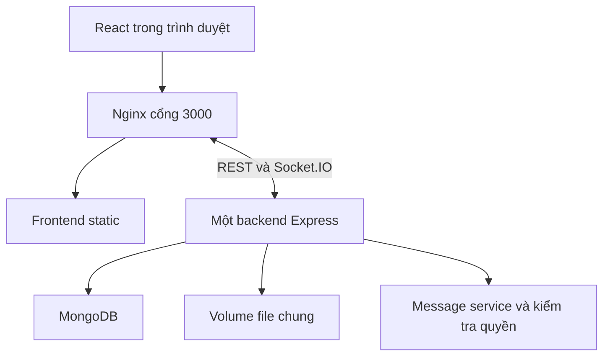
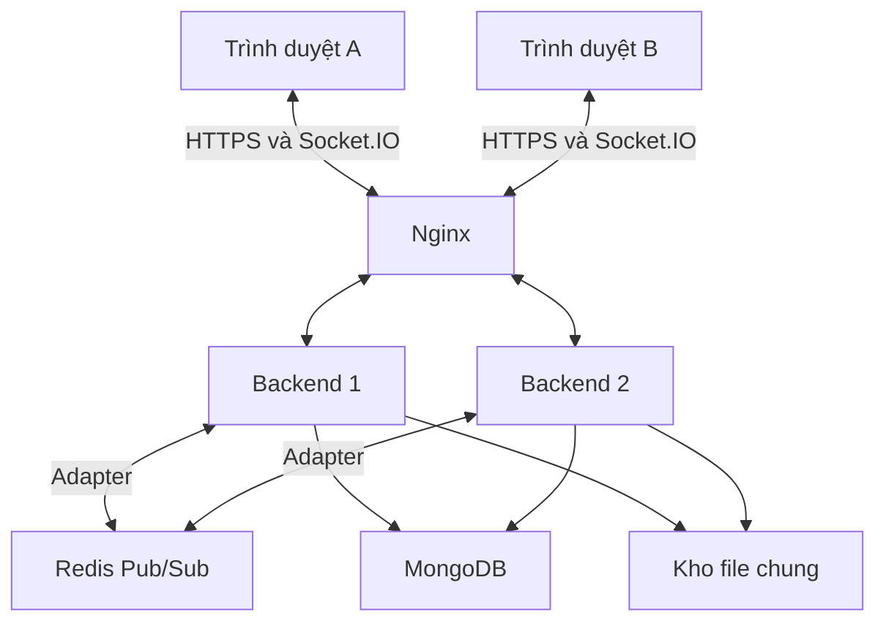
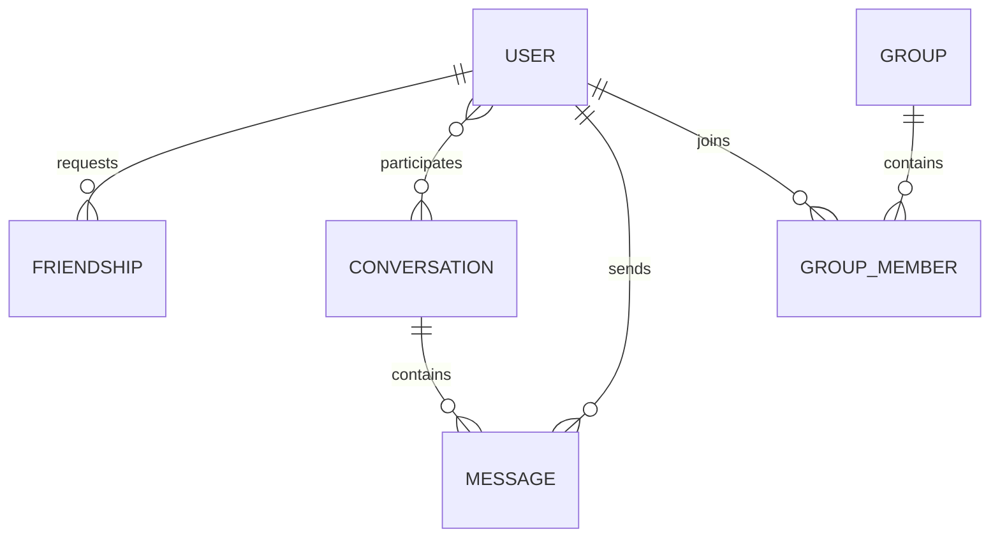
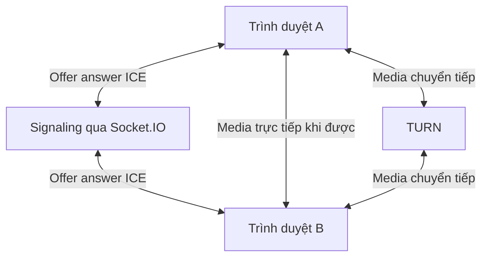

# Kiến trúc hiện tại và kiến trúc mục tiêu

## Bản đã điều chỉnh

Backend có một entrypoint `server/src/index.js`, chạy trực tiếp bằng Node.js. Tất cả module dùng JavaScript ESM với import/export và đường dẫn tương đối có đuôi `.js`. Frontend React dùng `.jsx`; các service, store, utility và cấu hình Vite dùng `.js`. REST và Socket.IO gọi chung message service và kiểm tra thành viên trước khi xử lý. Backend hiện chạy một instance.

Redis được cấp sẵn trong Compose nhưng chưa có kết nối từ backend. Presence vẫn dùng Map trong một process. Client dùng phiên có số thứ tự và AbortSignal để từ chối response thuộc tài khoản trước. File upload còn dùng URL công khai. Không gọi bản này là hoàn thành Level 4.

## Mục tiêu Level 4 cần phát triển

Nginx phân phối kết nối; Redis Adapter chuyển tiếp sự kiện; MongoDB lưu dữ liệu lâu dài. Cần thêm cache có TTL/invalidation và presence phân tán theo từng socket có heartbeat. Khi giữ polling phải cấu hình sticky session; WebSocket-only đơn giản hơn nhưng mất fallback. Backend crash và Redis mất kết nối phải có kịch bản thử riêng. Một Redis và một MongoDB vẫn là các điểm có thể gây gián đoạn.

## Luồng tin nhắn hiện tại

Client tạo clientMessageId, gửi bằng socket và đợi ACK. Nếu ACK timeout, thử REST với cùng ID. Service kiểm tra quyền, suy ra recipient, upsert theo khóa chống trùng, cập nhật lastMessage và phát một lần vào hợp các user room. UI gộp theo message ID. Việc phát lại sự kiện vẫn có thể xảy ra khi retry; không gọi đây là exactly-once end-to-end.

Lịch sử lấy theo cursor (createdAt, _id), 50 tin mới nhất mỗi trang. Client lưu mốc của lần tải lịch sử thành công gần nhất trong tab. Sau reconnect, client lùi cursor đến khi gặp mốc đó, gộp các trang theo ID và giữ cursor của phần lịch sử cũ đã tải. Kết quả chỉ cập nhật sau khi toàn bộ lần đồng bộ thành công; nếu lỗi giữa chừng có thể thử lại. Khi mở app mới chưa có mốc, lấy trang mới nhất và tải trang cũ theo yêu cầu.

## Mô hình dữ liệu đang dùng

Group và GroupMember chưa nối vào luồng hội thoại. Đề xuất cho Level 2: thêm Conversation.groupId; GroupMember là nguồn quyền cho nhóm; thêm lastReadMessageId vào GroupMember; recipient chỉ bắt buộc với tin cá nhân. Quyền trưởng nhóm dựa trên Group.creator và quy tắc đã thống nhất. Thiết kế migration cụ thể trước khi đưa dữ liệu thật vào.

## Luồng WebRTC cần phát triển

Socket.IO không truyền luồng âm thanh/video trong thiết kế này. Cần getUserMedia, RTCPeerConnection, STUN/TURN, HTTPS khi chạy ngoài localhost và dọn media tracks khi kết thúc. Nút gọi đang bị vô hiệu hóa đến khi nhóm triển khai xong.
